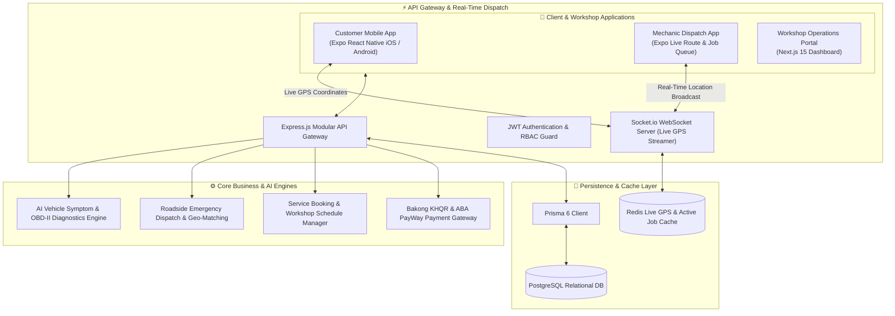
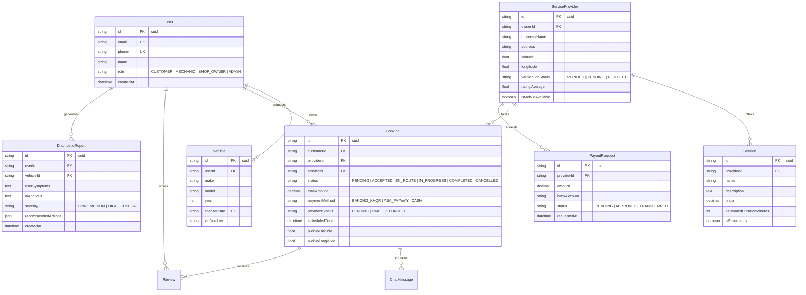
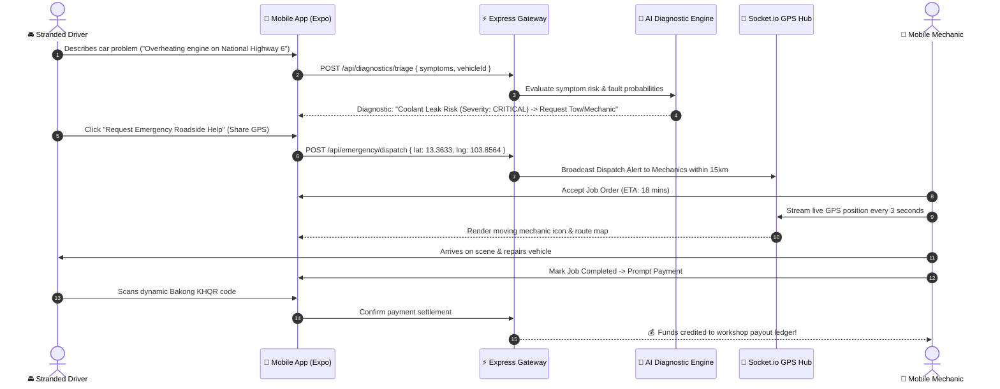

# 🚗 TechTune Healer — Automotive Care, Roadside Assistance & AI Diagnostics Platform

<div align="center">


**A full-stack on-demand automotive services marketplace and emergency breakdown platform for Cambodia. Connects car owners with verified repair workshops and mobile mechanics, featuring real-time GPS tracking, AI symptom diagnostics, and digital KHQR payments.**

[System Architecture](#-system-architecture) • [Database ERD](#-database-erd) • [Emergency Dispatch Sequence](#-emergency-dispatch--tracking-flow) • [Quick Start](#-quick-start)

</div>

---

## ⚡ Overview

**TechTune Healer** solves vehicle breakdown anxiety across Cambodian highways and cities. Drivers can instantly diagnose vehicle warning lights and odd noises via an AI symptom triaging engine, broadcast emergency roadside assistance requests to nearby verified mechanics with live GPS tracking, and complete seamless contactless payments via **Bakong KHQR** and **ABA PayWay**.

---

## 🏗️ System Architecture



---

## 📊 Database ERD



---

## 🔄 Emergency Dispatch & Tracking Flow



---

## 🚀 Quick Start

### 1. Backend API Setup
```bash
cd backend
pnpm install

# Push Database Schema
pnpm prisma db push

# Start Backend (Port 5000)
pnpm run dev
```

### 2. Admin Web Portal Setup
```bash
cd ../admin-web
pnpm install
pnpm run dev
```

### 3. Mobile App Setup (Expo)
```bash
cd ..
pnpm install
pnpm start
```

---

## 📄 License
MIT License © **[Ros Rendo](https://github.com/RosRendo)**
